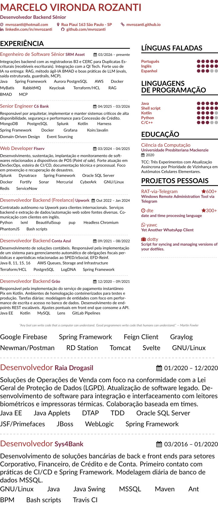

# CV — Marcelo Vironda Rozanti

Four tailored CVs in one repo: **2 languages (en, ptbr) × 2 framings (default, bot)**.

|          | default (hand-authored altacv) | bot (ATS plain-text) |
|----------|--------------------------------|----------------------|
| **en**   | `en/default`                   | `en/bot`             |
| **ptbr** | `ptbr/default`                 | `ptbr/bot`           |

## Build

    make            # all four -> build/<id>.pdf
    make en-default # just one
    make check      # build + assert no orphan trailing pages
    make preview    # regenerate preview.png

See `CLAUDE.md` for editing rules (source of truth, no-info-loss, no-orphan-pages, parity, tailoring).
